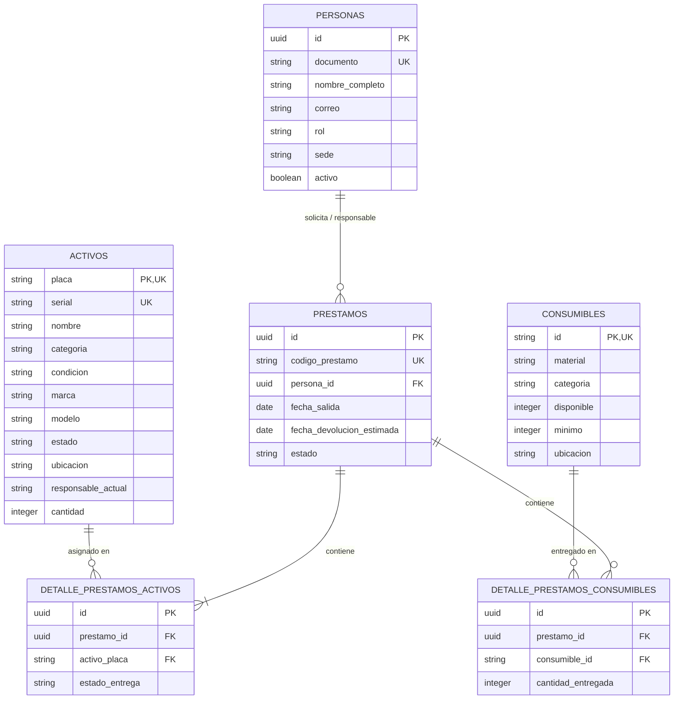

# Documentación Técnica del Modelo de Datos - SIGA FMO

## Diagrama Entidad-Relación (ERD)

## Matriz de Restricciones e Integridad Referencial

| Entidad | Campo | Tipo de Clave / Restricción | Descripción |
| :--- | :--- | :--- | :--- |
| **PERSONAS** | `id` | Primary Key (`PK`, `UUID`) | Identificador único del usuario o responsable. |
| **PERSONAS** | `documento` | Unique Key (`UK`) | Cédula o documento de identidad único. |
| **ACTIVOS** | `placa` | Primary Key / Unique (`PK`, `UK`) | Código de placa único institucional. |
| **ACTIVOS** | `serial` | Unique Key (`UK`) | Serial de fábrica único por activo físico. |
| **CONSUMIBLES** | `id` | Primary Key / Unique (`PK`, `UK`) | Código alfanumérico identificador del material. |
| **PRESTAMOS** | `id` | Primary Key (`PK`, `UUID`) | Identificador único del encabezado del préstamo. |
| **PRESTAMOS** | `codigo_prestamo` | Unique Key (`UK`) | Código de radicación único para seguimiento. |
| **PRESTAMOS** | `persona_id` | Foreign Key (`FK`) $\rightarrow$ `PERSONAS(id)` | Responsable/solicitante del préstamo (`ON DELETE RESTRICT`). |
| **DETALLE_PRESTAMOS_ACTIVOS** | `id` | Primary Key (`PK`, `UUID`) | Identificador único del ítem asignado. |
| **DETALLE_PRESTAMOS_ACTIVOS** | `prestamo_id` | Foreign Key (`FK`) $\rightarrow$ `PRESTAMOS(id)` | Préstamo contenedor (`ON DELETE CASCADE`). |
| **DETALLE_PRESTAMOS_ACTIVOS** | `activo_placa` | Foreign Key (`FK`) $\rightarrow$ `ACTIVOS(placa)` | Activo asignado (`ON UPDATE CASCADE`). |
| **DETALLE_PRESTAMOS_CONSUMIBLES** | `id` | Primary Key (`PK`, `UUID`) | Identificador del consumible entregado. |
| **DETALLE_PRESTAMOS_CONSUMIBLES** | `prestamo_id` | Foreign Key (`FK`) $\rightarrow$ `PRESTAMOS(id)` | Préstamo contenedor (`ON DELETE CASCADE`). |
| **DETALLE_PRESTAMOS_CONSUMIBLES** | `consumible_id` | Foreign Key (`FK`) $\rightarrow$ `CONSUMIBLES(id)` | Material consumible entregado (`ON UPDATE CASCADE`). |
