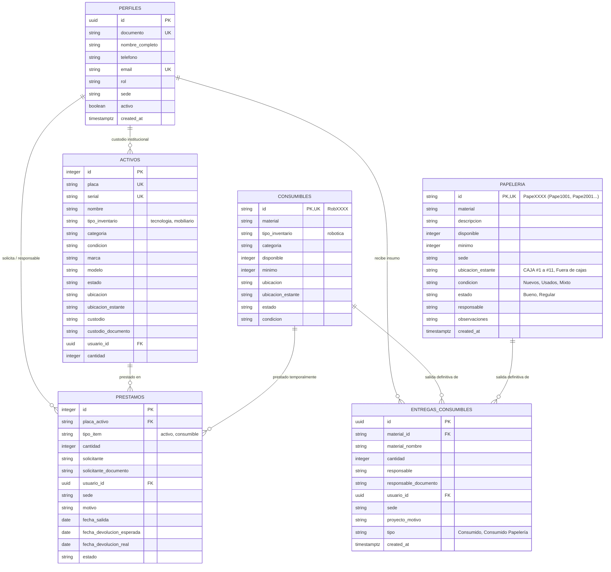

# Documentación Técnica del Modelo de Datos - SIGA FMO

## Diagrama Entidad-Relación (ERD)

## Matriz de Restricciones e Integridad Referencial

| Entidad | Campo | Tipo de Clave / Restricción | Descripción |
| :--- | :--- | :--- | :--- |
| **PERFILES** | `id` | Primary Key (`PK`, `UUID`) | Identificador único del perfil (compatible con `auth.users.id`). |
| **PERFILES** | `documento` | Unique Key (`UK`) | Cédula o documento de identidad único institucional. |
| **PERFILES** | `email` | Unique Key (`UK`) | Correo electrónico institucional único. |
| **PERFILES** | `rol` | Check Constraint | Valores permitidos: `'administrador'`, `'operador'`, `'supervisor'`, `'usuario'`. |
| **ACTIVOS** | `placa` | Primary Key / Unique (`UK`) | Código de placa único institucional (`P{n+1}` para tecnología, `MOB{n+1}` para mobiliario). |
| **ACTIVOS** | `serial` | Unique Index Condicional | Serial de fábrica único por activo físico (excluyendo vacíos, `S/N`, `N/A`). |
| **ACTIVOS** | `tipo_inventario` | Check / Default | Dominio: `'tecnologia'`, `'mobiliario'`. |
| **ACTIVOS** | `ubicacion_estante` | VARCHAR | Estante, caja, gaveta o armario físico. |
| **CONSUMIBLES** | `id` | Primary Key (`PK`, `UK`) | Código alfanumérico identificador (`Rob{n+1}` para robótica). |
| **PAPELERIA** | `id` | Primary Key (`PK`, `UK`) | Código institucional `PapeXXXX` (ej. `Pape1001` - Caja 1, `Pape2001` - Caja 2). |
| **PAPELERIA** | `ubicacion_estante` | VARCHAR(100) | Caja contenedora física (`CAJA #1` a `CAJA #11`, `Fuera de cajas`). |
| **PAPELERIA** | `disponible` | Check Constraint | `disponible >= 0` (Control atómico de existencias). |
| **PRESTAMOS** | `id` | Primary Key (`PK`, `SERIAL`) | Identificador del préstamo. |
| **PRESTAMOS** | `placa_activo` | Reference | Código de activo o consumible prestado. |
| **PRESTAMOS** | `solicitante_documento`| Reference / Lookup | Vínculo con `PERFILES(documento)`. |
| **ENTREGAS_CONSUMIBLES** | `id` | Primary Key (`PK`, `UUID`) | Identificador único de salida definitiva. |
| **ENTREGAS_CONSUMIBLES** | `material_id` | Foreign Key $\rightarrow$ `CONSUMIBLES(id)` / `PAPELERIA(id)` | Insumo entregado. |
| **ENTREGAS_CONSUMIBLES** | `responsable_documento` | Reference / Lookup | Vínculo con `PERFILES(documento)`. |

---

## Políticas de Seguridad RLS (Row Level Security)

1. **`admin_all_perfiles`:** Acceso total (`SELECT`, `INSERT`, `UPDATE`, `DELETE`) para usuarios con rol `'administrador'`.
2. **`staff_select_perfiles`:** Permisos de solo lectura (`SELECT`) para usuarios con rol `'supervisor'` y `'operador'`.
3. **`user_own_perfil`:** Los usuarios con rol `'usuario'` solo pueden consultar y actualizar su propio perfil (`id = auth.uid()` o coincidencia de correo).
4. **`Acceso completo a papeleria`:** `CREATE POLICY "Acceso completo a papeleria" ON public.papeleria FOR ALL TO public USING (true) WITH CHECK (true);`
